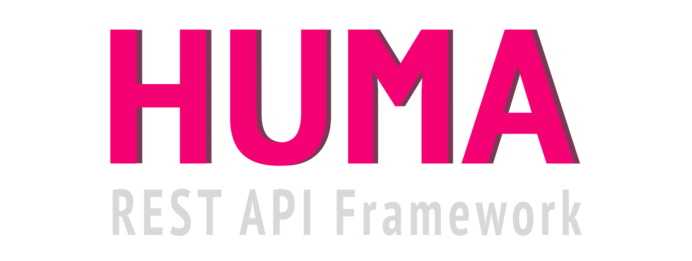

<div style="display:flex; justify-content: center;">

</div>

# Biodiversity and Occurrences for Molecular Ecology


BiOME is a self-hostable platform (specifically a [LIMS](https://en.wikipedia.org/wiki/Laboratory_information_management_system)) for managing and analyzing taxonomic occurrence data supporting research in ecology and biodiversity.

In ecology, an occurrence is defined as the reported presence of a specific taxon in one location, at a specific time. Generating occurrences typically involves sampling specimens on the field and sorting the specimen by assigning them a taxonomic identification, either using morphological criteria or molecular barcoding.

## Dev environment

### Setup

1. Install golang >= 1.24
2. Setup `GOBIN` environment variable in your shell profile
3. Add it to your `PATH` environment variable
4. Install [air](github.com/cosmtrek/air@latest) to handle hot-reloading of the server:

   ```bash
   go install github.com/cosmtrek/air@latest
   ```
5. Database setup
  - install [Gel CLI](https://docs.geldata.com/reference/cli)
  - run `gel project init` in the project directory

6. Client setup
- Install `nodejs >= 23`
- Install [pnpm](https://pnpm.io/installation)
- run `pnpm i` in the `/client` directory

### Running the local server

- run `air` in the `/server` directory
- run `pnpm dev` in the `/client` directory

## Publish Docker images

Add `DOCKERHUB_USERNAME` and `DOCKERHUB_TOKEN` to the repository's GitHub Actions secrets. The Docker Hub token must have write access to `lsdch/biome-backend` and `lsdch/biome-frontend`.

The backend build checks out the pinned `lsdch/huma` fork into `server/huma`. If the fork is private, add a `HUMA_READ_TOKEN` Actions secret with read access to that repository.

Create a tag on a commit that contains the workflow and push it to GitHub.

```bash
git tag -a v1.2.3 -m "Release v1.2.3"
git push git@github.com:lsdch/BiOME.git refs/tags/v1.2.3
```

The workflow runs for tags in the `vMAJOR.MINOR.PATCH` format and publishes both images with the Git tag as their Docker tag. After both images are pushed, it creates a GitHub release for the same tag with automatically generated release notes. If a release already exists for the tag, the workflow preserves it.

## Built with

<div style="display:flex">
<a href="https://vuejs.org/">

</a>

<a href="https://vuetifyjs.com/">

</a>


<a href="https://huma.rocks/">

</a>

<a href="https://www.geldata.com/">

</a>


</div>
